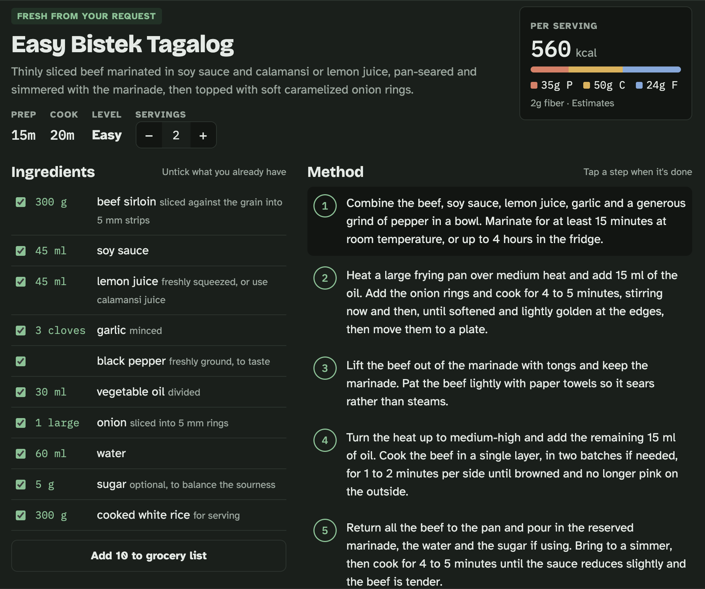
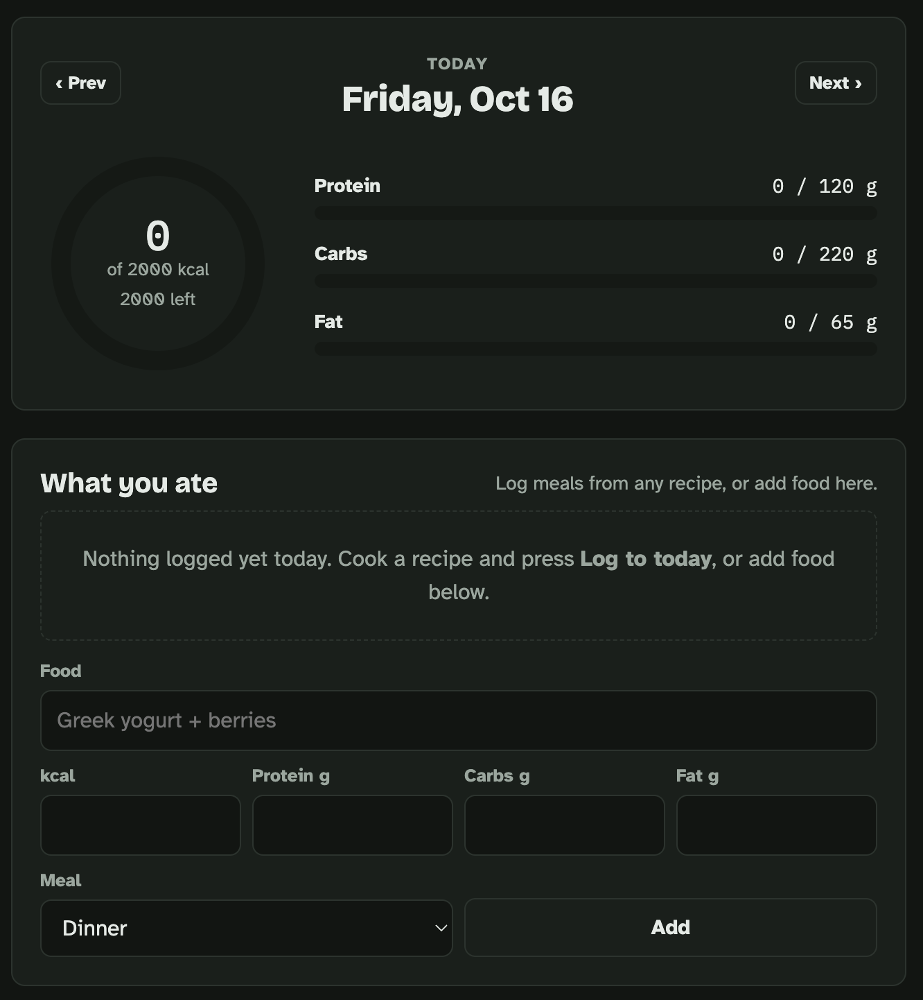
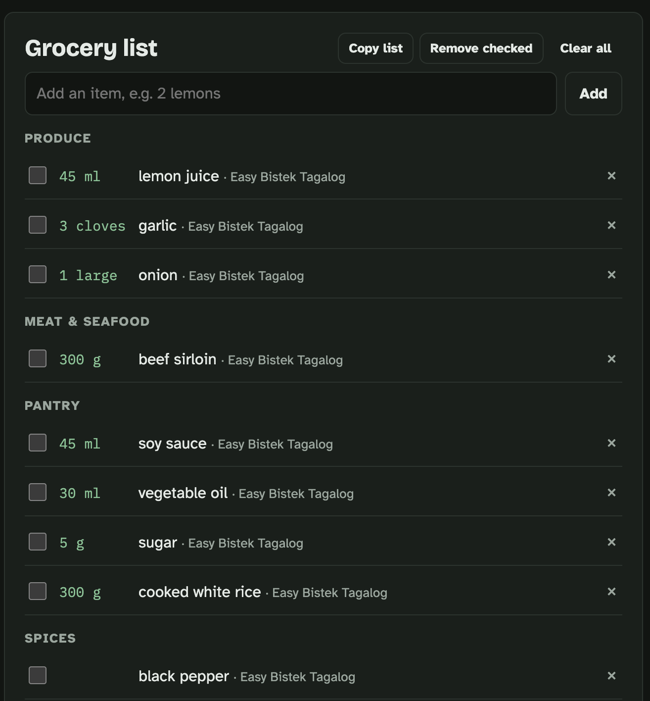

# Pantry to Plate

Pantry to Plate is a cooking app where you describe what you want to eat, and it gives you an easy step-by-step recipe that fits your servings, time limit, diet and the ingredients you already have. It also estimates calories, protein, carbs and fat for each recipe, tracks what you eat against your daily goals, and turns the ingredients you still need into a grocery list grouped by store section.

| Macro tracker | Grocery list |
|---|---|
|  |  |

## Features

**Cook**
- Ask for any dish in plain words, or get six ideas when you're not sure what you want
- Set servings, a time limit, US or metric units, a nutrition goal, foods to avoid and ingredients on hand
- Recipes have 5–9 short steps with times, temperatures and doneness cues; tap a step to mark it done
- Change the servings and every ingredient amount rescales
- Save recipes you like so you never have to search for them again

**Today (macro tracker)**
- Log a recipe in one tap, or add any food by hand
- Calorie ring and protein / carbs / fat bars measured against daily goals you set
- Browse previous days

**Groceries**
- Untick the ingredients you already have, then add the rest to the list
- Items are grouped by store section, and the same item from two recipes merges into one line
- Check items off, remove them, or copy the whole list as text

## How it's built

- One self-contained `index.html`: plain HTML, CSS and JavaScript, with no framework and no build step
- Responsive from phone to desktop, with light and dark themes
- Recipe writing runs on Claude through the Claude Artifacts runtime (`sample` capability), with recipes returned as structured JSON
- Data saves to the signed-in user's Claude account (`db` capability), and falls back to browser storage when that isn't available
- AI output is escaped before it reaches the page

Built with [Claude Code](https://claude.com/claude-code).

## Running it

Open `index.html` in a browser, or serve the folder with any static host such as GitHub Pages.

Outside Claude, recipe writing is turned off. The three built-in starter recipes, the macro tracker and the grocery list all work, and data is saved in your browser.

## Notes

- Nutrition values are estimates based on standard values for the listed ingredients, not lab measurements.
